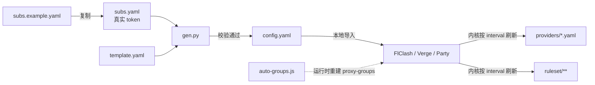

# subbrew

把多个机场订阅聚合成**一份** mihomo（Clash.Meta）配置：按订阅、地区、服务自动分组，一次导入 FlClash / Clash Verge Rev / Clash Party 三端通用。

- 订阅增减只改 `subs.yaml`，不用在客户端之间来回切换
- 节点与规则集都由内核按 `interval` 自行刷新，静态文件可长期使用
- 附带 DNS 防污染、fake-ip、域名嗅探、广告拦截与常用服务分流

## 特性

| 能力 | 说明 |
|---|---|
| 多订阅聚合 | 每条订阅生成独立 `proxy-provider`，独立刷新、独立测延迟 |
| 每订阅分组 | 自动生成 `{名称} · 自动`（url-test）与 `{名称} · 手动`（select） |
| 跨订阅汇总 | `♻️ 自动选择`、`{地区} 节点` 组用 `include-all-providers` 聚合全部订阅 |
| 服务分流 | AI / Telegram / YouTube / Netflix / Spotify / Google / GitHub / 游戏 / 广告拦截等专用组 |
| DNS 净化 | fake-ip + `respect-rules` + 国内外 DoH 分离，降低污染与泄漏 |
| 域名嗅探 | TLS / QUIC / HTTP 还原真实域名，修正 fake-ip 下的裸 IP 误判 |
| 规则集外置 | 19 个 rule-provider（mrs + blackmatrix7），内核按天刷新 |
| 两条路径 | `gen.py` 生成静态 `config.yaml`；或用 `auto-groups.js` 在客户端运行时建组 |

## 项目结构

```
subs.example.yaml  订阅清单示例（入库，占位地址）
subs.yaml          真实订阅清单（含 token，.gitignore 排除）
template.yaml      DNS / TUN / 嗅探 / 分组 / 规则模板
gen.py             生成器 + 校验器（唯一第三方依赖 PyYAML）
config.yaml        生成产物（含真实订阅 URL，.gitignore 排除）
auto-groups.js     客户端运行时分组脚本（三端通用）
```

运行期由内核创建 `providers/`、`ruleset/` 缓存目录，同样不入库。

## 快速开始

要求：Python 3.7+、PyYAML；mihomo 内核 1.19.32+（已在 1.19.33 实测）。

```bash
git clone https://github.com/908652987/subbrew.git
cd subbrew

cp subs.example.yaml subs.yaml
$EDITOR subs.yaml          # 填写 name / id / url，id 用 ASCII 小写且唯一

python3 gen.py --check     # 只校验，不写文件
python3 gen.py             # 生成 config.yaml
```

然后在客户端导入本地文件：

| 客户端 | 导入入口 |
|---|---|
| FlClash | 配置 → 本地文件 → `config.yaml` |
| Clash Verge Rev | 订阅 → 新建 → 本地 → `config.yaml` |
| Clash Party | 配置 → 本地文件 → `config.yaml` |

导入后内核会自行拉取订阅与规则集；只有**修改 `subs.yaml`** 才需要重新生成并重新导入。

## 工作方式



`gen.py` 做三件事：

1. 读取 `subs.yaml`，为每条订阅生成 `proxy-providers.<id>` 与一对 `自动 / 手动` 分组；
2. 把这些 YAML 片段替换进 `template.yaml` 的三个占位注释：
   `# {{PROVIDERS}}`、`# {{SUB_GROUP_REFS}}`、`# {{SUB_GROUPS}}`；
3. 校验渲染结果（YAML 可解析、分组非空、规则目标可解析），通过后才写入 `config.yaml`。

占位符是列 0 的精确注释串，改动缩进或文字会导致替换失效。

### 分组一览

| 分组 | 类型 | 作用 |
|---|---|---|
| `🚀 节点选择` | select | 默认出口，规则未命中时的主入口 |
| `♻️ 自动选择` | url-test | 全部订阅里自动选最快节点 |
| `🎯 全局直连` | select | DIRECT |
| `🐟 漏网之鱼` | select | `MATCH` 兜底 |
| `🇭🇰/🇹🇼/🇯🇵/🇸🇬/🇰🇷/🇺🇸 节点` | url-test | 按节点名正则跨订阅汇总 |
| `🌍 其他地区` | select | 排除上述地区后的剩余节点 |
| `🤖 AI服务`、`✈️ 电报消息`、`📹 油管视频` … | select | 服务级分流 |
| `🛑 广告拦截` | select | `REJECT` / `DIRECT` |
| `{订阅名} · 自动` | url-test | 只在该订阅内部选节点 |
| `{订阅名} · 手动` | select | 固定使用该订阅的某个节点 |

需要"某订阅挂掉时自动换别的订阅"时，规则目标指向 `♻️ 自动选择` 或 `🐟 漏网之鱼`；指向 `{订阅名} · 自动` 只会在该订阅内部挑选。

## 订阅清单字段

`subs.yaml` 与 `subs.example.yaml` 结构相同：

| 键 | 默认 | 说明 |
|---|---|---|
| `name` | `订阅{i}` | 分组显示名，必须唯一 |
| `id` | 由 `name` 派生 | provider 键名与缓存文件名，建议 ASCII 小写且唯一 |
| `url` | 必填 | 机场订阅地址（含 token） |
| `prefix` | `"[{name}] "` | 节点名前缀，`""` 关闭 |
| `udp` | `true` | 未写即给所有节点开 UDP |
| `interval` | `3600` | provider 刷新间隔（秒） |
| `tfo` | — | 强制开启 TCP Fast Open |
| `additional-suffix` | — | 节点名后缀 |
| `proxy-name` | — | 正则改名，先于前后缀执行 |
| `header` | — | 自定义请求头（部分机场按 UA 区分客户端） |
| `exclude-filter` | 内置规则 | 剔除"剩余流量 / 到期 / 官网"等假节点 |
| `health-check-url` | `test-url` | 该订阅单独的测速地址 |

顶层还可设置 `exclude-filter`（全局默认）与 `test-url`（测速地址）。

订阅必须是 **Clash 格式 YAML**；base64 / v2ray 分享链接需要先用 Sub-Store 或 subconverter 转换。

## 用 auto-groups.js 代替生成器

`auto-groups.js` 不生成配置，而是在客户端加载配置时**整体重建 `proxy-groups`**：

- 适配已有 `proxy-providers` 的 profile，新增/删除订阅后无需重新生成
- 只改分组，不碰 `dns` / `sniffer` / `rule-providers` / `rules`
- 入口 `main(config, profileName)`，仅 ES2015，无网络/文件 IO
- 组名必须与模板一致，否则规则目标失效

入口位置：Verge Rev「配置 → 新建 → Script」、Clash Party「覆写 → JavaScript」、FlClash「配置 → 覆写脚本」。裸 profile 只有 `proxy-providers` 时不要单独用它，否则会出现"有分组、无分流"。

## 常用命令

```bash
python3 gen.py --check      # 校验 subs.yaml 与渲染结果，不写文件
python3 gen.py              # 生成 / 覆盖 config.yaml
node --check auto-groups.js # JS 语法检查
python3 -c 'import yaml; yaml.safe_load(open("config.yaml")); print("ok")'
```

内核侧自检（改 DNS / 规则 / 分组后建议执行）：

```bash
mkdir -p /tmp/mihomo-home
mihomo -t -d /tmp/mihomo-home -f config.yaml
# 期望：configuration file ... test is successful
```

`-t` 只验证配置可解析、引用自洽，不会下载订阅，也不校验订阅可达性。

## 注意事项

- `subs.yaml`、`config.yaml`、`providers/`、`ruleset/` 均被 `.gitignore` 排除；不要把真实 token 提交进仓库
- 三个客户端都会用 GUI 设置覆盖 `tun` / `mixed-port` / `mode`；Verge / Party 的「DNS 覆写」打开时，本配置的 DNS 段会失效
- 每个 `rule-provider` 必须保留 `proxy: DIRECT`，否则 `respect-rules: true` 下规则集下载会跟着代理走
- `global-client-fingerprint` 在 mihomo 1.19.x 已移除，需要统一指纹时用 provider 的 `override-expr`
- 本仓库无 CI、无测试框架；回归标准是 `gen.py --check` 退出码 0 + `mihomo -t` 通过

## License

[MIT](LICENSE)
